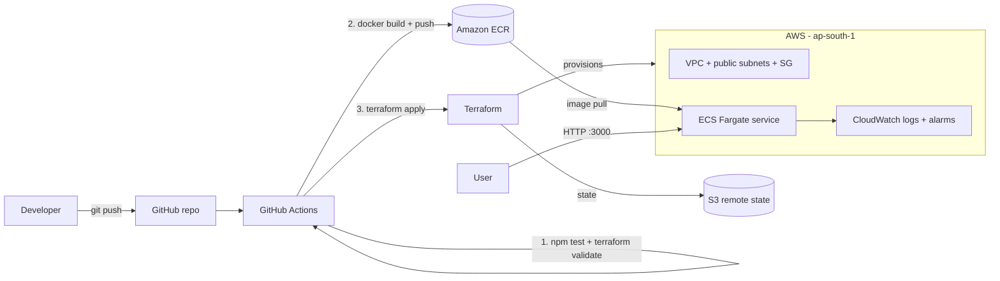

# End-to-End CI/CD Pipeline on AWS with Terraform

A small Node.js app that is **tested, containerized, pushed to Amazon ECR and deployed to Amazon ECS (Fargate) automatically on every push to `main`**. All AWS infrastructure is created with Terraform and its state is stored remotely in S3.

## Architecture



## What it demonstrates

| Area | Implementation |
|---|---|
| CI | GitHub Actions runs unit tests and `terraform validate` on every push and pull request |
| Containers | Dockerfile (Alpine base, runs as non-root user), image scanned on push to ECR |
| Registry | Amazon ECR, images tagged with the Git commit SHA, lifecycle policy keeps the last 10 |
| IaC | Terraform: VPC, subnets, route table, security group, ECR, ECS, IAM role, CloudWatch |
| Remote state | S3 backend with native state locking (`use_lockfile`) |
| CD | Pipeline applies Terraform with the new image tag, waits for ECS to stabilise, then smoke-tests the app |
| Monitoring | CloudWatch log group (7 day retention) and CPU and memory alarms, optional email alerts via SNS |

## Project structure

```
.
├── app/                    # Node.js app, tests, Dockerfile
├── terraform/              # All AWS infrastructure
├── .github/workflows/
│   ├── deploy.yml          # test -> validate -> build -> push -> deploy -> smoke test
│   └── destroy.yml         # manual workflow to delete everything
└── README.md
```

## Setup (one time)

### 1. Prerequisites
- An AWS account and the AWS CLI configured locally (`aws configure`)
- A GitHub account and Git

### 2. Create the S3 bucket for Terraform state
Bucket names are global, so pick a unique one.

```bash
BUCKET=vishal-tfstate-$RANDOM
aws s3api create-bucket --bucket $BUCKET --region ap-south-1 \
  --create-bucket-configuration LocationConstraint=ap-south-1
aws s3api put-bucket-versioning --bucket $BUCKET \
  --versioning-configuration Status=Enabled
echo $BUCKET   # note this name
```

### 3. Create an IAM user for GitHub Actions
In the AWS console go to IAM > Users > Create user (for example `github-actions-deployer`), attach permissions and create an access key.

- For learning, `AdministratorAccess` is the simplest.
- For a stronger setup, restrict it to ECR, ECS, EC2/VPC, IAM, CloudWatch, SNS and the state bucket, or switch to OIDC (see "Improvements").

### 4. Add GitHub repository secrets
Repo > Settings > Secrets and variables > Actions > New repository secret:

| Secret | Value |
|---|---|
| `AWS_ACCESS_KEY_ID` | access key of the IAM user |
| `AWS_SECRET_ACCESS_KEY` | secret key of the IAM user |
| `TF_STATE_BUCKET` | the S3 bucket name from step 2 |

### 5. Push and watch it deploy
```bash
git init
git add .
git commit -m "Initial commit: CI/CD pipeline on AWS with Terraform"
git branch -M main
git remote add origin https://github.com/vishaalmeenaa/aws-cicd-terraform-pipeline.git
git push -u origin main
```
Open the **Actions** tab. The first run takes several minutes because it creates the whole infrastructure. The last step prints the app URL and calls `/health`.

## Verify

- **App:** open the URL printed in the "Smoke test" step (`http://<public-ip>:3000/`). The response shows the deployed Git commit SHA in `version`.
- **Logs:** CloudWatch > Log groups > `/ecs/cicd-demo`
- **Alarms:** CloudWatch > Alarms
- **Update test:** change the message in `app/server.js`, commit and push. The pipeline redeploys and `version` changes.

## Run the app locally

```bash
cd app
npm test
docker build -t cicd-demo-app .
docker run -p 3000:3000 cicd-demo-app
curl http://localhost:3000/health
```

## Clean up (important, to avoid AWS charges)

Go to Actions > **Destroy infrastructure** > Run workflow, type `destroy`.
Afterwards you can also delete the state bucket and the IAM user.

## Cost note

Fargate (0.25 vCPU, 0.5 GB), a public IPv4 address and CloudWatch logs are billed while the service runs. Destroy the stack when you are not demoing it.

## Possible improvements

- Replace access keys with **GitHub OIDC** and an IAM role
- Add an **Application Load Balancer** and HTTPS with ACM
- Add `terraform plan` output as a pull request comment
- Use Terraform modules and separate dev/prod environments
- Add image vulnerability gating (fail the pipeline on critical findings)
- Migrate the service to **EKS**
